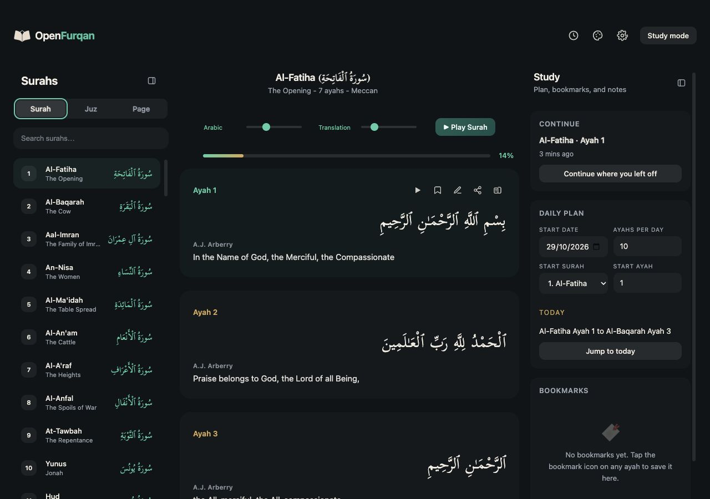
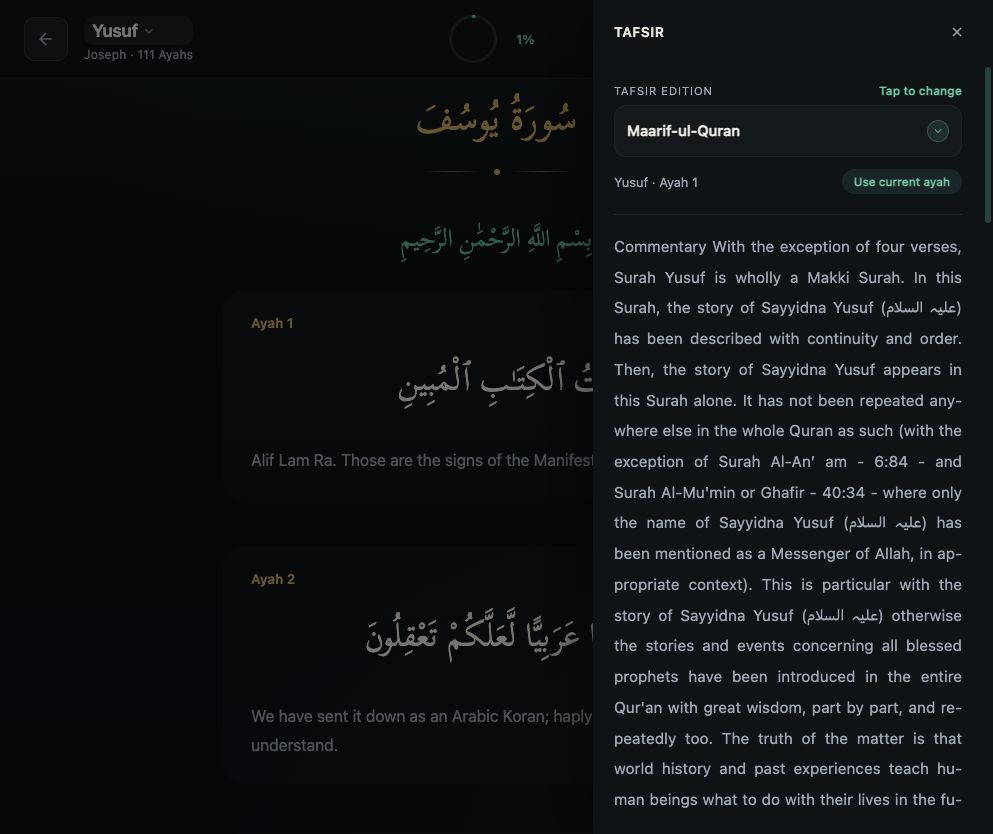
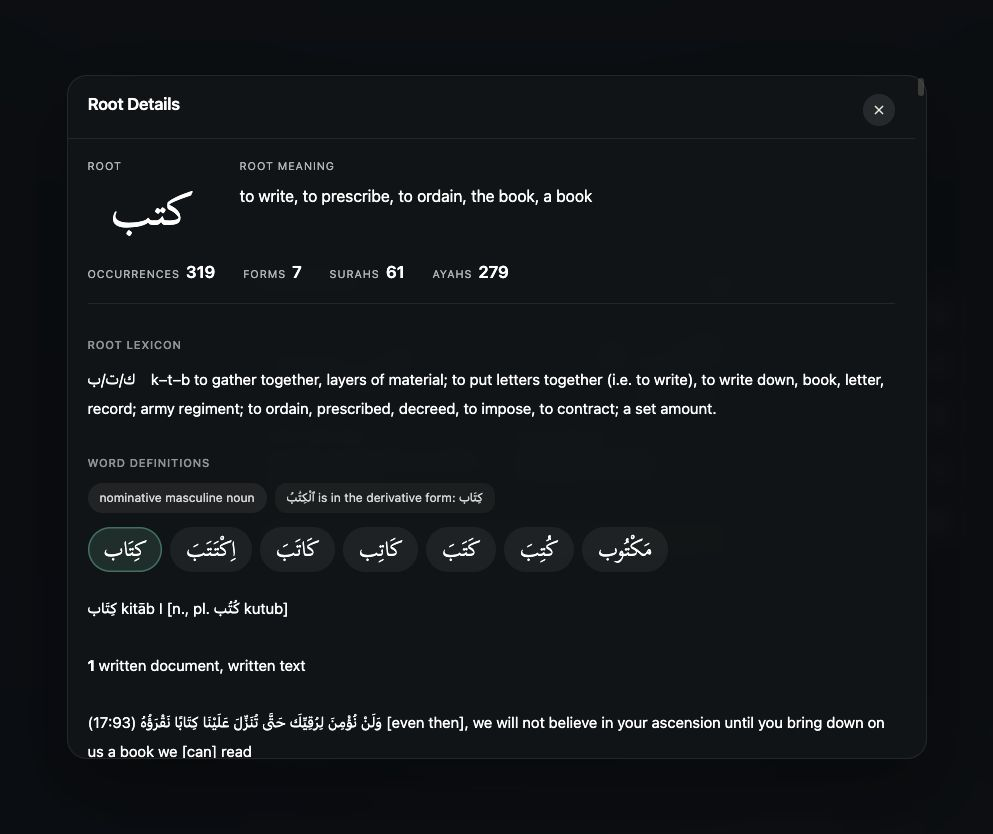
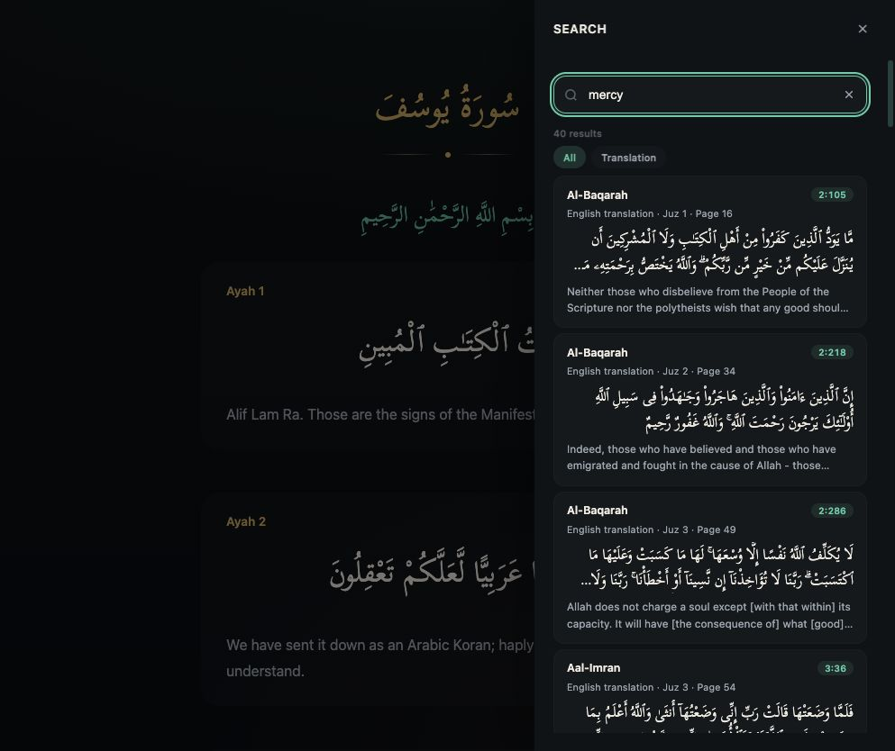
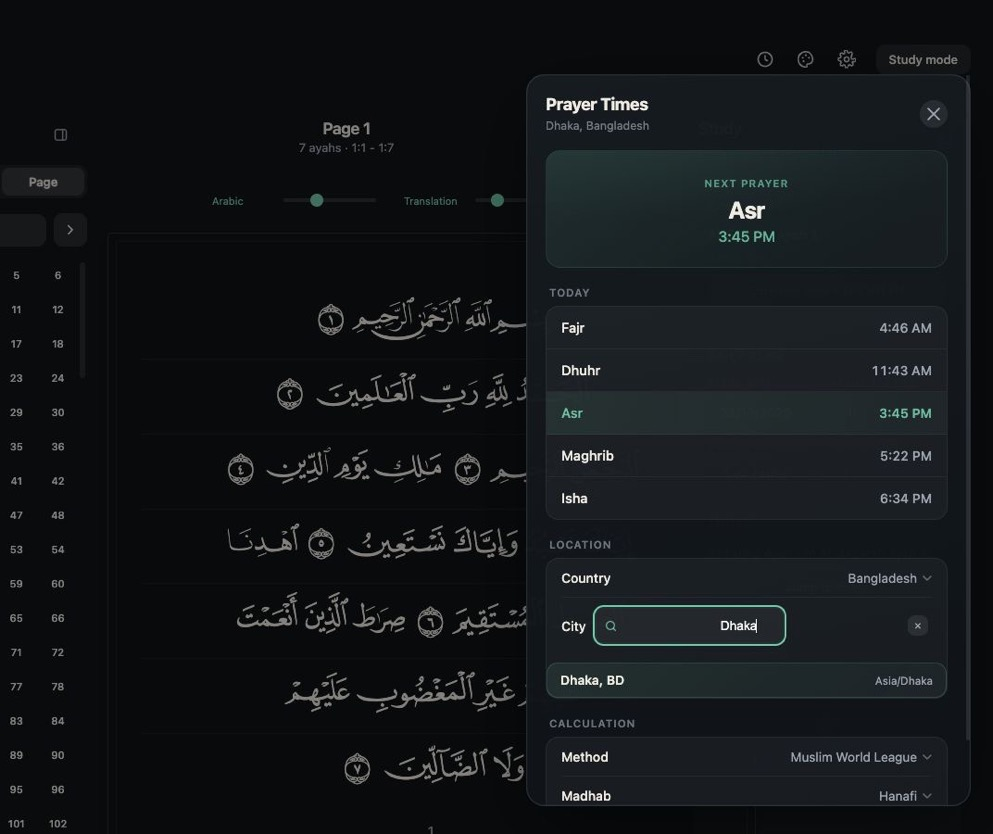

<p align="center">
  
</p>

<p align="center">
  <a href="https://openfurqan.com"><b>openfurqan.com</b></a> ·
  <a href="https://play.google.com/store/apps/details?id=com.openfurqan.app"><b>Get the Android app</b></a> ·
  <a href="https://github.com/OpenFurqanOrg/openfurqan-android"><b>OpenFurqan for Android</b></a>
</p>

# OpenFurqan for the web

The Quran in your browser, to read, listen to, study and memorize. Open any word for its meaning and
root, read tafsir beside the ayah, and turn the pages of the Mushaf as they are printed.

<p align="center">
  
  
</p>
<p align="center">
  
  
</p>

## Read
- By surah, by juz, or page by page through the 604-page Mushaf, set in its own page fonts
- Translations in nine languages, with word-by-word meanings and transliteration
- Tajweed colours, and six themes from Parchment to Dark

## Listen
- 16 reciters; with Al-Husary and Alafasy the text follows the recitation word by word
- Repeat an ayah until it stays with you

## Study
- Tap a word for its grammar, its root and its entry in Lane's Lexicon
- Eight tafsirs, among them Maarif-ul-Quran, al-Jalalayn and Asbab al-Nuzul
- Search in Arabic or in translation, by root or by ayah number
- Bookmarks, written and voice notes, and a daily reading plan

## Memorize
- Review ayahs with spaced repetition: each one comes back when it's due
- Mark the ayahs you've memorized on the Mushaf page

## And
- Prayer times for any city
- Install it from your browser and it opens like an app

There's no account and no ads. Your bookmarks, notes and progress stay in your browser.

## Building it

The Quran data comes from OpenFurqan's private data service. Running the site needs a key that only
the maintainers hold, so this repository is for reading and learning from the code rather than for
running your own copy of the site.

Without the key you can still run every check. You need Node.js 24 (see `.nvmrc`).

```sh
npm ci
npm test
```

| Command | What it does |
| --- | --- |
| `npm test` | Type-checks and runs the unit tests |
| `npm run lint` | Lints the code |
| `npm run check:themes` | Checks that every theme defines every colour |
| `npm run dev` | Runs the site locally (needs the data key) |
| `npm run build` | Builds the site for production (needs the data key) |

## How it's built

Next.js (App Router), React 19 and TypeScript.

| Folder | What's in it |
| --- | --- |
| `app/components/` | The reader, study panels, memorization and their dialogs |
| `app/api/` | Server routes that serve the prepared Quran data |
| `app/lib/` | Data loaders, search, the review scheduler and prayer locations |
| `app/contexts/`, `app/hooks/` | Preferences, bookmarks, notes and audio |
| `scripts/` | Data preparation and the build's checks |

How a build fetches and checks the data is in [docs/DATA.md](docs/DATA.md).

## Contributing

Found a bug or have an idea? [Open an issue](../../issues/new/choose). Pull requests are welcome
too; we build and try each one with the data before merging. Read [CONTRIBUTING.md](CONTRIBUTING.md)
first. Please report security problems privately, as [SECURITY.md](SECURITY.md) describes.

## License

The code is licensed under the [GNU Affero General Public License v3.0 only](LICENSE). The fonts
and the city list keep their own terms, listed below. The OpenFurqan name and logo aren't covered
by the licence: a fork needs its own name and logo. See [TRADEMARK.md](TRADEMARK.md).

## Credits

- **The KFGQPC Hafs, Hafs Smart and Uthmanic Naskh fonts** in `public/fonts` are by the King Fahd
  Glorious Quran Printing Complex. Their rights stay with their owners; this licence doesn't cover
  them.
- **City names, coordinates and time zones** are adapted from [GeoNames](https://www.geonames.org),
  under [CC BY 4.0](https://creativecommons.org/licenses/by/4.0/).
- **Prayer times** are calculated with [adhan-js](https://github.com/batoulapps/adhan-js).
